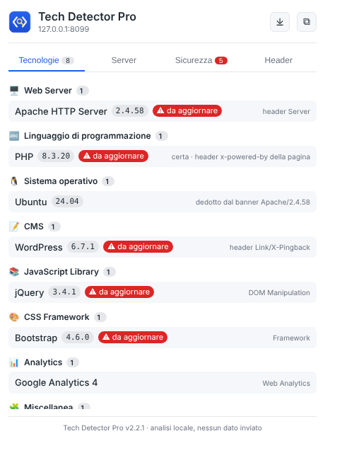
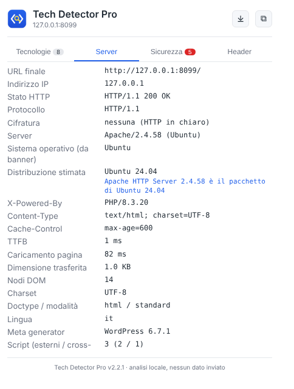
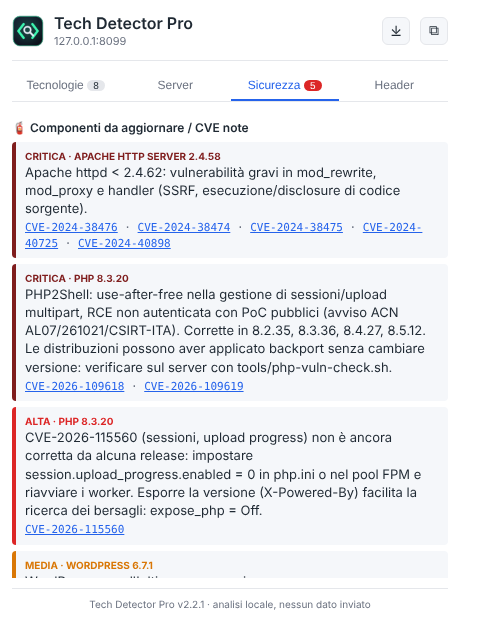
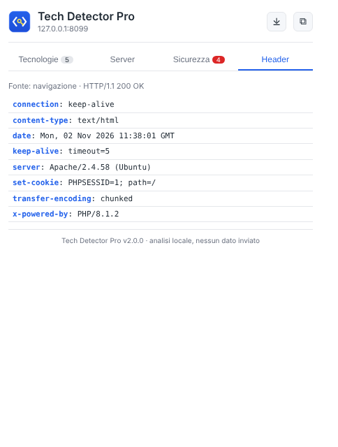
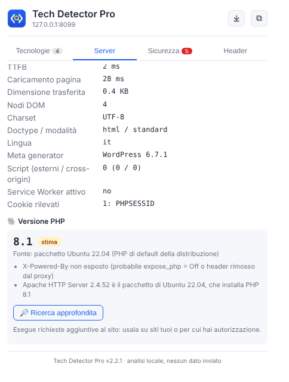
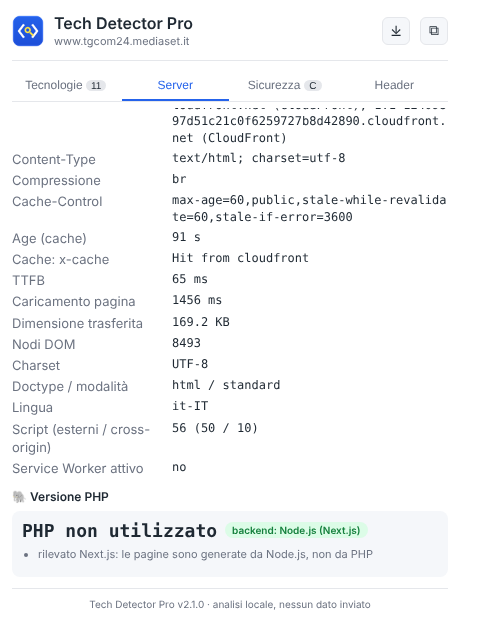

<p align="center"></p>

<h1 align="center">Tech Detector Pro</h1>

<p align="center">
  
  
  
  
  
</p>

<p align="center"><b>🇮🇹 <a href="#-italiano">Italiano</a> · 🇬🇧 <a href="#-english">English</a></b></p>

<p align="center">
  
  
  
  
</p>

---

## 🇮🇹 Italiano

**Tech Detector Pro** è un'estensione per Chrome ed Edge che, con un clic, dice **con che cosa è costruito un sito, quale software gira sul server e con quale versione, quanto è configurato bene e quali componenti vanno aggiornati** perché fuori supporto o esposti a CVE note.

Tutto avviene nel browser: nessun dato viene inviato a servizi esterni. Il progetto non ha dipendenze: JavaScript puro per l'estensione, shell POSIX/bash per gli strumenti.

### Cosa mostra

| Scheda | Contenuto |
|---|---|
| **Tecnologie** | CMS, framework e librerie JavaScript con la **versione reale** (jQuery, React, Vue, Angular/AngularJS, Next.js, Bootstrap, Lodash, WordPress…), CSS framework, analytics, tag manager, advertising, CDN, hosting, server e sistema operativo. Le tecnologie da aggiornare sono marcate con *⚠ da aggiornare* |
| **Server** | IP, stato HTTP, protocollo (HTTP/1.1, 2, 3), software e versione di **Apache, nginx, IIS, LiteSpeed, Tomcat, PHP, OpenSSL, ASP.NET**, distribuzione Linux stimata, cache e CDN, compressione, tempi di risposta, cookie e **versione di PHP** (vedi sotto) |
| **Sicurezza** | Componenti obsoleti o vulnerabili con gravità e link a NIST NVD, voto **A–F** sugli header (HSTS, CSP, X-Content-Type-Options, clickjacking, Referrer-Policy, Permissions-Policy, COOP, CORS), flag dei cookie, contenuti misti, Subresource Integrity, banner che rivelano versioni |
| **Header** | Tutti gli header HTTP della risposta |

Il report si esporta in **JSON** oppure si copia come testo negli appunti.

### Versione di PHP

Quasi tutti i siti in produzione nascondono la versione di PHP (`expose_php = Off`, oppure un proxy o CDN toglie `X-Powered-By`). L'estensione la cerca in quattro modi e indica sempre **fonte** e **affidabilità**:

| Livello | Tecnica | Affidabilità |
|---|---|---|
| 1 · automatico | `X-Powered-By` sulle risposte che PHP genera direttamente: pagina con cache-buster (salta la cache del CDN), `/index.php`, script `.php` inesistente (con nginx + PHP-FPM la pagina "File not found." la produce PHP), pagine tipiche del CMS | certa |
| 2 · su richiesta | Pulsante **🔎 Ricerca approfondita**: pagine `phpinfo()` dimenticate, file di Composer esposti, easter egg dei PHP < 5.5 | certa / probabile / minimo |
| 3 · stima | Pacchetto Apache/nginx della distribuzione → PHP di default (es. `Apache/2.4.52 (Ubuntu)` = Ubuntu 22.04 = PHP 8.1) | stima |
| 4 · minimo | Requisito del CMS o framework (es. Laravel 11 → PHP ≥ 8.2) | minimo |

Se il sito usa chiaramente un altro backend (Next.js → Node.js, ASP.NET, Java, Django, Rails, siti statici) compare **"PHP non utilizzato"** con il backend reale.

<p align="center"> </p>

### Come evita i falsi positivi

- Una tecnologia viene riconosciuta solo da **prove tecniche**: header, cookie, script caricati, oggetti JavaScript, marcatori specifici. La semplice comparsa di una parola nel testo della pagina non basta.
- **Database, cache, linguaggi e web server** non sono visibili dal browser. Se risultano solo dal testo (per esempio una dashboard che elenca "Redis" tra i servizi monitorati) vengono **scartati**.
- **PWA** richiede manifest **e** service worker attivo; **Firebase** richiede il vero SDK.
- Per i siti che rispondono 200 a qualsiasi indirizzo (applicazioni a pagina singola, router applicativi) una richiesta di controllo evita di scambiarli per siti PHP.
- Le versioni **stimate** non generano avvisi "critici" come se fossero certe.

### Strumenti a riga di comando (`tools/`)

L'estensione vede solo ciò che il server **espone**. Per riscontrare una segnalazione, per esempio di CSIRT Italia/ACN, servono anche verifiche sul server:

| Script | Dove | Cosa fa |
|---|---|---|
| `php-exposure-scan.sh` | dalla tua postazione | 3 richieste per sito: versione PHP esposta, PHP con versione nascosta, confronto con le soglie di sicurezza |
| `php-vuln-check.sh` | **sul server**, sola lettura | trova tutte le installazioni PHP (CLI, FPM, CGI, LiteSpeed, Remi, Plesk, cPanel, Bitnami, Docker), riconosce i **backport** delle distribuzioni dai changelog dei pacchetti, controlla i parametri `php.ini` e dei pool FPM. Exit code 1 se serve intervenire, `--csv` per l'inventario |
| `build-icons.sh` | sviluppo | rigenera le icone PNG da `icons/icon.svg` (rsvg-convert, Inkscape o ImageMagick) |
| `build-zip.sh` | sviluppo | crea in `dist/` lo zip da pubblicare su Chrome Web Store / Edge Add-ons |

```bash
./tools/php-exposure-scan.sh -f siti.txt
sudo ./tools/php-vuln-check.sh
sudo ./tools/php-vuln-check.sh --csv > inventario.csv
```

> **PHP2Shell (avviso ACN AL07/261021/CSIRT-ITA).** CVE-2026-109618 e CVE-2026-109619 sono corrette in **8.2.35, 8.3.36, 8.4.27 e 8.5.12**. Per 7.4, 8.0 e 8.1 esistono solo backport minimi in sorgente o patch delle distribuzioni. **CVE-2026-115560 non è corretta da nessuna release**: va mitigata con `session.upload_progress.enabled = 0` in `php.ini` o nel pool FPM (non con `ini_set()` o `.user.ini`), riavviando i worker.

### Installazione

1. Scarica il repository: `git clone https://github.com/umeglio/TechDetectorPro.git`, oppure *Code → Download ZIP*
2. Apri `chrome://extensions` (o `edge://extensions`) e attiva la **Modalità sviluppatore**
3. Clicca **Carica estensione non pacchettizzata** e seleziona la cartella del progetto
4. Ricarica le schede già aperte: gli header vengono letti durante la navigazione

### Permessi

| Permesso | Perché |
|---|---|
| `activeTab`, `scripting` | analizzare la pagina della scheda attiva |
| `webRequest` | leggere (solo osservazione) gli header della risposta principale |
| `storage` | conservare gli header per scheda durante la sessione; vengono cancellati alla chiusura della scheda |
| `http://*/*`, `https://*/*` | leggere header e IP di qualsiasi sito analizzato |

### Limiti

- Si vede solo ciò che il server rivela: con header `Server` e `X-Powered-By` nascosti la versione non è rilevabile da fuori.
- Debian, Ubuntu e RHEL correggono le vulnerabilità **senza cambiare il numero di versione**: un avviso dell'estensione va confermato sul server con `php-vuln-check.sh`.
- Le regole CVE sono locali (aggiornate a novembre 2026) e si trovano in `analyzer.js` → `VULN_RULES`.
- La ricerca approfondita e gli script inviano richieste ai siti: usali su sistemi tuoi o per cui hai l'autorizzazione.

### Struttura del progetto

```
├── manifest.json        configurazione Manifest V3
├── background.js        service worker: header, IP e stato HTTP della pagina
├── detector.js          riconoscimento tecnologie dalla pagina
├── pageinfo.js          versioni delle librerie, prestazioni, cookie, SRI
├── analyzer.js          analisi header, voto di sicurezza, regole CVE/EOL
├── phpprobe.js          individuazione della versione PHP
├── popup.html/.css/.js  interfaccia
├── icons/               icon.svg (sorgente) e PNG 16/32/48/128
├── screenshots/         immagini del README
└── tools/               script shell (verifiche PHP, icone, pacchetto zip)
```

### Contribuire

Le pull request sono benvenute, in particolare per nuove regole in `VULN_RULES`: indica sempre la fonte e le CVE. Lo storico delle versioni è in [CHANGELOG.md](CHANGELOG.md).

---

## 🇬🇧 English

**Tech Detector Pro** is a Chrome and Edge extension that tells you, in one click, **what a website is built with, which server software and version it runs, how well it is configured, and which components need updating** because they are end-of-life or affected by known CVEs.

Everything runs in the browser and no data is sent anywhere. The project has no dependencies: plain JavaScript for the extension, POSIX shell/bash for the tools.

### What it shows

| Tab | Content |
|---|---|
| **Technologies** | CMS, JavaScript frameworks and libraries with their **real version** (jQuery, React, Vue, Angular/AngularJS, Next.js, Bootstrap, Lodash, WordPress…), CSS frameworks, analytics, tag managers, ads, CDN, hosting, server and operating system. Components to update are flagged *⚠ da aggiornare* |
| **Server** | IP, HTTP status, protocol (HTTP/1.1, 2, 3), software and version of **Apache, nginx, IIS, LiteSpeed, Tomcat, PHP, OpenSSL, ASP.NET**, estimated Linux distribution, cache/CDN, compression, timings, cookies and the **PHP version** |
| **Security** | Outdated or vulnerable components with severity and NIST NVD links, **A–F grade** on security headers, cookie flags, mixed content, Subresource Integrity, version-leaking banners |
| **Headers** | All HTTP response headers |

Reports can be exported as **JSON** or copied as text. The interface is in Italian.

### PHP version

Most production sites hide the PHP version. The extension searches in four layers and always reports **source** and **confidence**:
1. `X-Powered-By` on PHP-generated responses: cache-busted page, `/index.php`, a non-existent `.php` script, CMS endpoints (certain).
2. On-demand **deep search**: forgotten `phpinfo()` pages, exposed Composer files, the PHP < 5.5 easter egg.
3. Estimate from the distribution package, e.g. `Apache/2.4.52 (Ubuntu)` → Ubuntu 22.04 → PHP 8.1.
4. Minimum required by the detected CMS or framework.

Sites clearly running another backend (Next.js → Node.js, ASP.NET, Java, Django, Rails, static sites) show **"PHP non utilizzato"** (PHP not used).

### Avoiding false positives

- Technologies are recognised only from **technical evidence** (headers, cookies, loaded scripts, JavaScript globals, specific markers), never from a word in the page text.
- **Databases, caches, languages and web servers** are invisible to a browser. Text-only matches are **discarded**.
- **PWA** needs a manifest **and** an active service worker; **Firebase** needs the real SDK.
- A control request detects catch-all sites that answer 200 to any URL, so they are not mistaken for PHP.
- **Estimated** versions never raise "critical" CVE warnings.

### Command-line tools (`tools/`)

| Script | Where | What it does |
|---|---|---|
| `php-exposure-scan.sh` | your workstation | 3 requests per site: exposed PHP version, hidden PHP, comparison with security thresholds |
| `php-vuln-check.sh` | **on the server**, read-only | finds every PHP install (CLI, FPM, CGI, LiteSpeed, Remi, Plesk, cPanel, Bitnami, Docker), detects distribution **backports** in package changelogs, checks `php.ini` and FPM pool settings; exit code 1 when action is needed, `--csv` for inventories |
| `build-icons.sh` | development | rebuilds PNG icons from `icons/icon.svg` (rsvg-convert, Inkscape or ImageMagick) |
| `build-zip.sh` | development | creates the store-ready zip in `dist/` |

> **PHP2Shell (ACN advisory AL07/261021/CSIRT-ITA).** CVE-2026-109618 and CVE-2026-109619 are fixed in **8.2.35, 8.3.36, 8.4.27 and 8.5.12**. 7.4/8.0/8.1 only have minimal source backports or distribution patches. **CVE-2026-115560 has no fix yet**: set `session.upload_progress.enabled = 0` in `php.ini` or the FPM pool, then restart the workers.

### Installation

1. `git clone https://github.com/umeglio/TechDetectorPro.git` (or *Code → Download ZIP*)
2. Open `chrome://extensions` (or `edge://extensions`) and enable **Developer mode**
3. Click **Load unpacked** and select the project folder
4. Reload tabs that were already open

### Permissions

`activeTab` and `scripting` to inspect the active page; `webRequest` to observe (read-only) the main response headers; `storage` for per-tab session data, cleared when the tab closes; `http://*/*` and `https://*/*` to read headers and IP of any analysed site.

### Limitations

- Only what the server discloses can be detected.
- Distributions backport fixes without changing the version string: confirm warnings on the server with `php-vuln-check.sh`.
- CVE rules are local (updated November 2026) and live in `analyzer.js` → `VULN_RULES`.
- Deep search and the scripts send requests to the target: use them only on systems you own or are authorised to test.

### License

MIT, see [LICENSE](LICENSE). Version history: [CHANGELOG.md](CHANGELOG.md).

---

<p align="center"><b>Autore / Author:</b> Umberto Meglio · realizzato con il supporto di Claude di Anthropic</p>
